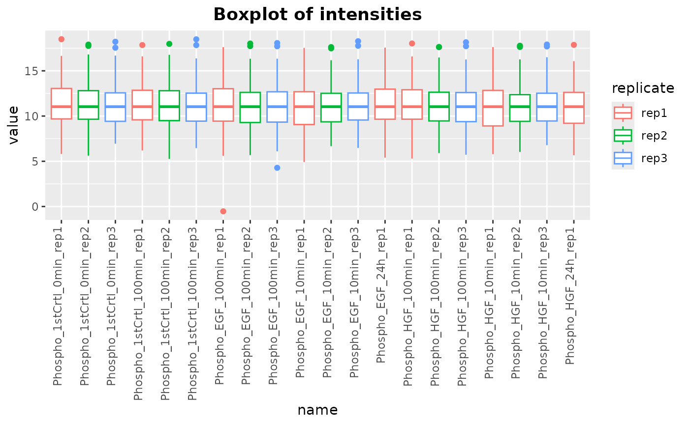
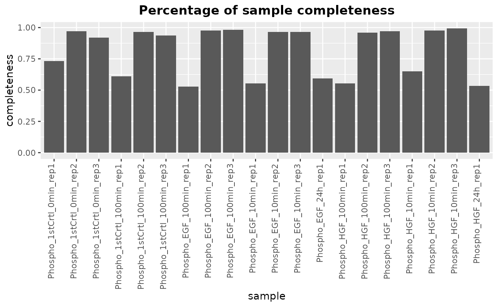
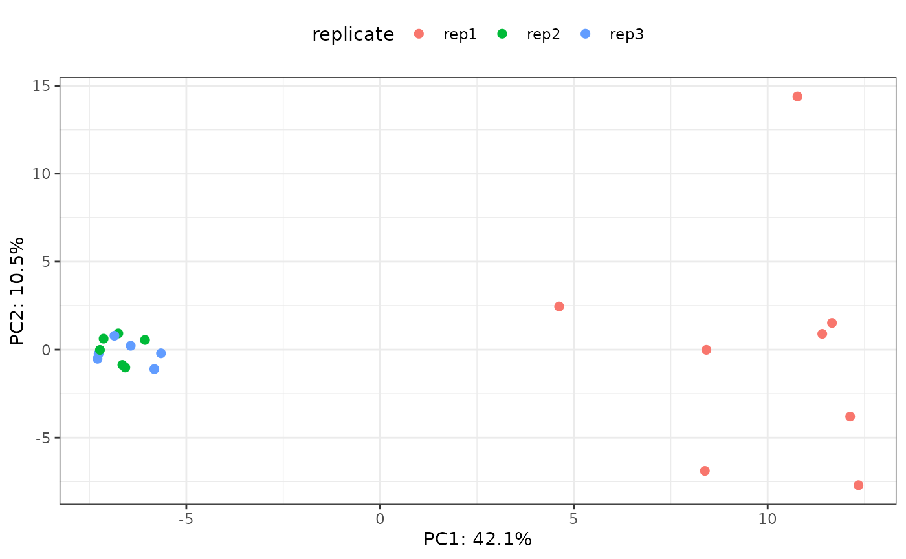
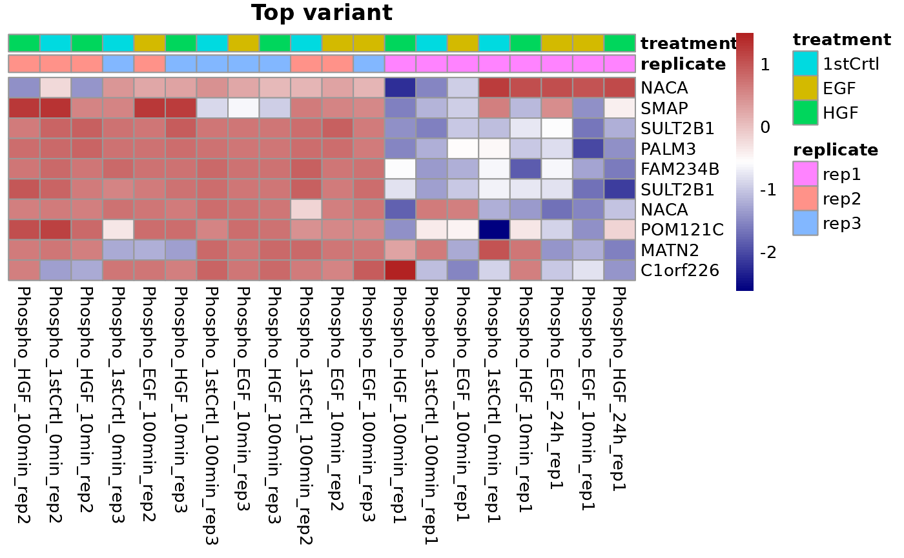
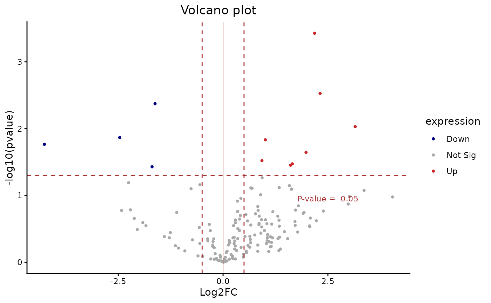
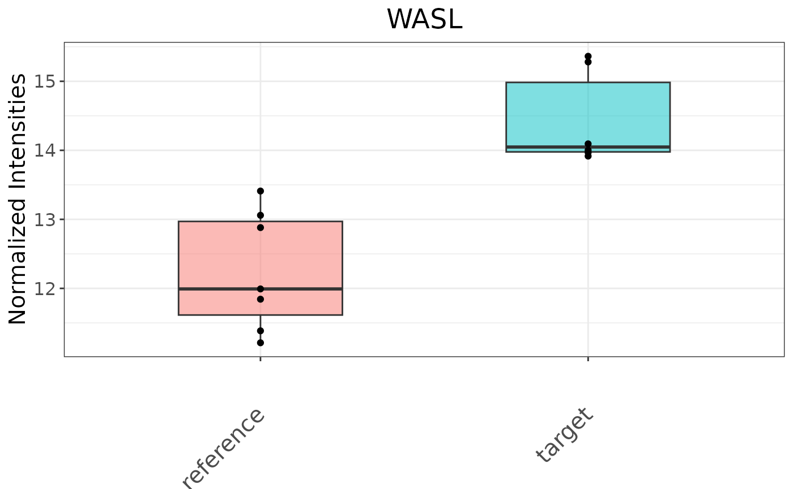
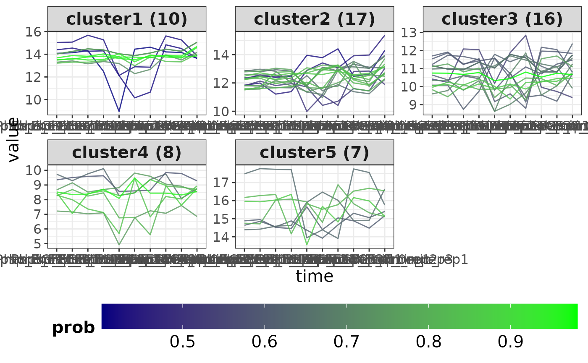
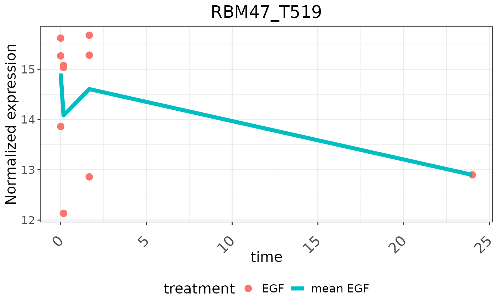
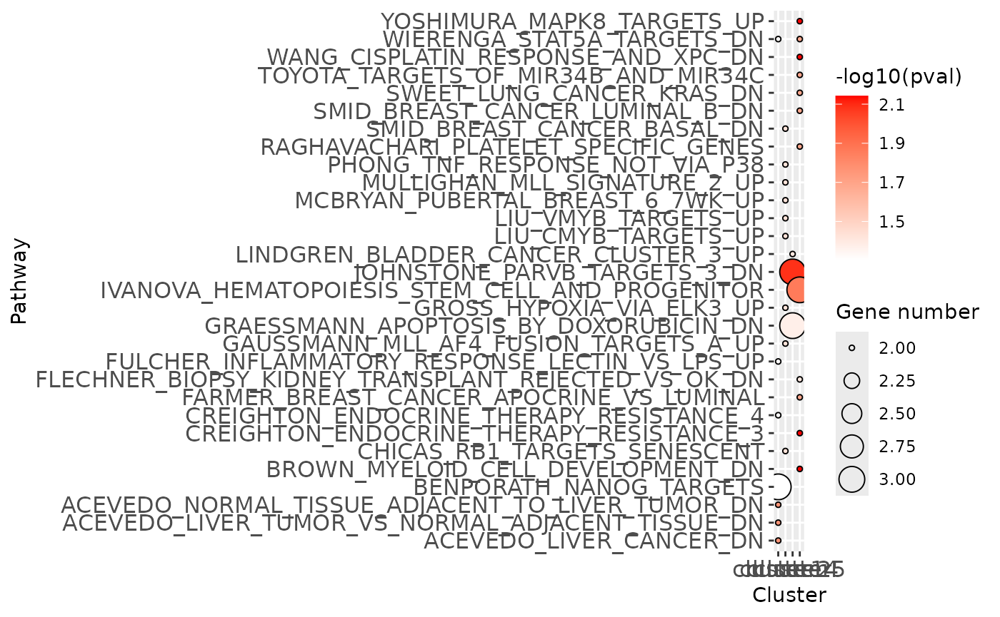
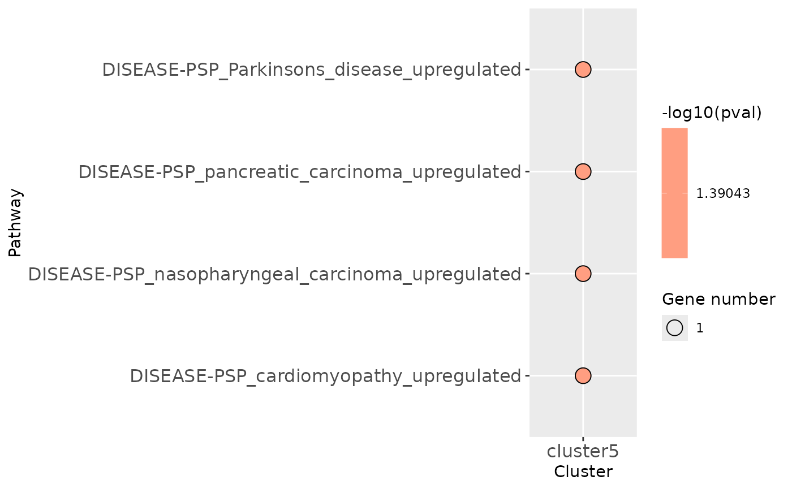

# SmartPhos: a pipeline for processing and analysis of phosphoproteomic data

## Introduction

Phosphoproteomics provides rich information for dissecting pathway
activities and therefore is becoming vital in basic and translational
biomedical research. To facilitate and streamline phosphoproteomics data
analysis, we developed `SmartPhos`, an R package for the pre-processing,
quality control, and exploratory analysis of phosphoproteomics data
generated by mass-spectrometry. SmartPhos can process outputs from
`MaxQuant` and `Spectronaut` either using the R command line or in an
interactive ShinyApp called `SmartPhos Explorer`. Besides commonly used
preprocessing steps, such as normalization, transformation, imputation,
and batch effect correction, our package features a novel method for
correcting normalization artifacts observed in phosphoproteomics,
especially when large global phosphorylation changes are expected, by
taking both phospho-enriched and unenriched samples into account.

In addition, the `SmartPhos Explorer` `ShinyApp` included in our R
package provides a user-friendly and interactive one-stop solution for
performing exploratory data analysis (PCA, hierarchical clustering,
etc.), differential expression, time-series clustering, gene set
enrichment analysis, and kinase activity analysis easily without the
knowledge of coding or the underlying statistical model.

This vignette focuses on using `SmartPhos` with the R command line.

## Install and load SmartPhos Package

To install `SmartPhos` enter the following to the `R` console

``` r

if (!requireNamespace("BiocManager", quietly = TRUE))
    install.packages("BiocManager")
BiocManager::install("SmartPhos")
```

Load the package

``` r

library(MultiAssayExperiment)
library(SmartPhos)
```

Load the R object

``` r

data("dia_example")
dia_example
```

    ## A MultiAssayExperiment object of 2 listed
    ##  experiments with user-defined names and respective classes.
    ##  Containing an ExperimentList class object of length 2:
    ##  [1] Phosphoproteome: SummarizedExperiment with 500 rows and 47 columns
    ##  [2] Proteome: SummarizedExperiment with 500 rows and 47 columns
    ## Functionality:
    ##  experiments() - obtain the ExperimentList instance
    ##  colData() - the primary/phenotype DataFrame
    ##  sampleMap() - the sample coordination DataFrame
    ##  `$`, `[`, `[[` - extract colData columns, subset, or experiment
    ##  *Format() - convert into a long or wide DataFrame
    ##  assays() - convert ExperimentList to a SimpleList of matrices
    ##  exportClass() - save data to flat files

## Preprocessing the assay, basic visualization, PCA and Heatmaps

Extract the SummarizedExperiment object from the multiAssayExperiment
object

``` r

se <- dia_example[["Phosphoproteome"]]
colData(se) <- colData(dia_example)
se
```

    ## class: SummarizedExperiment 
    ## dim: 500 47 
    ## metadata(0):
    ## assays(1): Intensity
    ## rownames(500): s1 s2 ... s499 s500
    ## rowData names(7): UniprotID Gene ... Sequence site
    ## colnames(47): FullProteome_1stCrtl_0min_rep2
    ##   FullProteome_1stCrtl_0min_rep3 ... Phospho_HGF_24h_rep1
    ##   Phospho_HGF_100min_rep1
    ## colData names(6): sample treatment ... sampleType sampleName

### Preprocessing options

SmartPhos package performs some pre-filtering and preprocessing based on
various threshold values during the generation of the
multiAssayExperiment object. On top of that, this panel has different
options for preprocessing of the selected assay. The options provided by
the shiny app are as follows:

- **Normalization correction**: This option is present only if the
  phophoproteomics data is present. It allows for the correction of
  normalization artefacts introduced by the Spectronaut.
- **Normalize** phospho intensity by the corresponding protein
  expression.
- **Transformation**: The transformation methods available are: log2 and
  vst (variance stabilizing transformation).
- **Normalization**: Normalization strategy depends on the selected
  transformation method. Therefore, the user has option of *Yes* or
  *No*. If the user selects *Yes*, then for log2 and no transformation,
  *median scaling* is applied and for vst, *vsn* is applied.
- **Missing values**: Users can select what percentage of missing values
  are allowed. Proteins with missing values above the selected threshold
  will be removed from all analyses.
- **Imputation**: Currently four imputation methods are available:
  - QRILC (Quantile Regression Imputation of Left-Censored data)
  - MinDet (Deterministic minimal value approach)
  - BPCA (Bayesian PCA)
  - MLE (Maximum Likelihood Estimation)
  - Random forest
- **Batch effects removal**: This option provides the abilty to correct
  for batch effects. It uses *removeBatchEffect()* from the *limma*
  package. The users can select the maximum of two columns. The columns
  used for batch effects removal should be present in the fileTable.txt
  file.

The preprocessing (transformation, normalization, imputation, etc.) on
the intensity assay can be performed by running the following command:

``` r

newSE <- preprocessPhos(seData = se, transform = "log2", normalize = TRUE, 
                        impute = "QRILC")
```

### Different visualization options

Plot the boxplot of assay intensities:

``` r

plotIntensity(newSE, colorByCol = "replicate")
```



Plot the completeness (percentage of non-missing) for each sample:

``` r

plotMissing(newSE)
```

 This is performed
on the original assay and not on the imputed assay.

Perform principal component analysis (PCA) by running the following
command:

``` r

# perform PCA
pca <- stats::prcomp(t(assays(newSE)[["imputed"]]), center = TRUE, 
                     scale. = TRUE)
# call the plotting function
p <- plotPCA(pca = pca, se = newSE, color = "replicate")
p
```



Heatmap can be plotted using the plotHeatmap() function of SmartPhos.
There are three different heatmaps possible based on the **type**
argument:

- **Top variant**: This allows the users to plot the genes with highest
  variance. Users can decide the number of top variants genes to plot.
  This option performs clustering automatically. The user also has the
  option to divide the columns and rows of the heatmap into specific
  number of clusters using the **cutCol** and **cutRow** arguments.
- **Differentially expressed**: Allows to plot the heatmaps for
  differentially expressed genes. The differential expression analysis
  is available in *Differential expression* tab and can be performed
  using ProDA or Limma.
- **Selected time series cluster**: After performing the time-series
  clustering in another tab, users have option to plot the heatmap of
  the selected cluster.

``` r

plotHeatmap(type = "Top variant", newSE, top = 10, 
            annotationCol = c("replicate", "treatment"))
```



## Differential Expression Analysis

The goal of performing differential expression analysis is to quantify
the expression levels of genes between different experimental conditions
using statistical tests.

If the users want paired t-test on the patient IDs, cell lines, etc,
then the users must have **subjectID** as one of the column in the
*fileTable.txt* file with the relevant information. The subjectID column
should also be selected in the additional column annotations before the
generation of multiAssayExperiment object.

The *performDifferentialExp()* has two methods for performing
differential expression analysis:

- **limma**: uses linear models.
- **ProDA**: uses probabilistic dropout model.

Limma method needs an assay with non-missing data and is faster than the
proDA method. ProDA method can work on assay with missing values also.

``` r

dea <- performDifferentialExp(se = newSE, assay = "imputed", method = "limma", 
                              condition = "treatment", reference = "EGF", 
                              target = "1stCrtl")
```

‘dea’ is a list object which contains two values: ‘resDE’ with tabular
differential expression analysis results and ‘seSub’ which is the
subsetted SummarizedExperiment object based on the selected condition.

``` r

dea$seSub
```

    ## class: SummarizedExperiment 
    ## dim: 172 13 
    ## metadata(0):
    ## assays(2): Intensity imputed
    ## rownames(172): s4 s6 ... s499 s500
    ## rowData names(7): UniprotID Gene ... Sequence site
    ## colnames(13): Phospho_1stCrtl_0min_rep2 Phospho_1stCrtl_0min_rep3 ...
    ##   Phospho_EGF_24h_rep1 Phospho_EGF_100min_rep1
    ## colData names(7): sample treatment ... sampleName comparison

``` r

dea$resDE
```

    ## # A tibble: 172 × 12
    ##    ID    log2FC  stat   pvalue   padj UniprotID      Gene  Multiplicity Position
    ##    <chr>  <dbl> <dbl>    <dbl>  <dbl> <chr>          <chr>        <int> <chr>   
    ##  1 s447   2.18   4.83 0.000373 0.0641 O00401         WASL             1 256     
    ##  2 s156   2.31   3.68 0.00296  0.243  A0A590UJ23;A0… PALM3            2 436     
    ##  3 s184  -1.62  -3.49 0.00423  0.243  A6NKD9         CCDC…            2 251     
    ##  4 s318   3.15   3.07 0.00933  0.401  O00139         KIF2A            1 484     
    ##  5 s28   -2.47  -2.87 0.0136   0.421  A0MZ66         SHTN1            1 101     
    ##  6 s4     1.01   2.83 0.0147   0.421  A0AV96         RBM47            1 519     
    ##  7 s203  -4.26  -2.75 0.0172   0.422  A7KAX9         ARHG…            2 44      
    ##  8 s381   1.98   2.60 0.0226   0.486  O00231         PSMD…            1 23      
    ##  9 s173   0.927  2.45 0.0302   0.534  A6NFI3         ZNF3…            3 10      
    ## 10 s157   1.65   2.39 0.0337   0.534  A0A590UJ23;A0… PALM3            2 439     
    ## # ℹ 162 more rows
    ## # ℹ 3 more variables: Residue <chr>, Sequence <chr>, site <chr>

Plot the volcano plot for the obtained differential expression analysis
results by running the following command:

``` r

plotVolcano(dea$resDE)
```



**pFilter** and **fcFilter** arguments can be used to change the
thresholds for the upregulated and downregulated genes being represented
in the volcano plot.

Use intensityBoxPlot() to plot the intensity data of a specified gene,
with optional subject-specific lines:

``` r

intensityBoxPlot(se = dea$seSub, id = 's447', symbol = "WASL")
```



## Time series clustering

Time series clustering is performed to group proteins/phosphopeptides
based on how their level changes over time. The *clusterTS()* function
employs **fuzzy c-means clustering** algorithm which considers the
time-resolved trend, but not the expression levels. Thus, members of the
same cluster would have a similar trend over time (e.g., all increasing
or all decreasing), though their expression level can be different.

To use this function, users must have logitudinal data with
**timepoint** annotation in their data. The time points are either
unit-less numbers (e.g., 1, 2, 3) or are in hour and/or minute, which
must be typed as “h” and “min”, respectively (e.g., 1min, 2min, 3h).
Please notice that mixing the two said options (e.g., 1, 2min, 3) or
using other unit for time (e.g., 1hour, 2minute, 3day) will likely lead
to wrong results.

``` r

# call addZeroTime function to add zero timepoint to EGF treatment
newSEzero <- addZeroTime(newSE, condition = "treatment", treat = "EGF", 
                         zeroTreat = "1stCrtl", 
                         timeRange = c("10min","100min", "24h"))
# extract the assay
exprMat <- SummarizedExperiment::assay(newSEzero)
# call the clustering function
tsc <- clusterTS(x = exprMat, k = 5)
```

‘tsc’ is a list object which contains two values: ‘cluster’ with tabular
time series clustering results and ‘plot’ with the clusters plots.

``` r

tsc$cluster
```

    ## # A tibble: 580 × 7
    ##    feature time                    value cluster   prob  cNum clusterNum   
    ##    <fct>   <fct>                   <dbl> <chr>    <dbl> <int> <chr>        
    ##  1 s499    Phospho_EGF_10min_rep2  14.1  cluster1 0.402    10 cluster1 (10)
    ##  2 s499    Phospho_EGF_10min_rep3  14.1  cluster1 0.402    10 cluster1 (10)
    ##  3 s499    Phospho_EGF_100min_rep2 14.3  cluster1 0.402    10 cluster1 (10)
    ##  4 s499    Phospho_EGF_100min_rep3 12.5  cluster1 0.402    10 cluster1 (10)
    ##  5 s499    Phospho_EGF_10min_rep1   8.96 cluster1 0.402    10 cluster1 (10)
    ##  6 s499    Phospho_EGF_24h_rep1    14.5  cluster1 0.402    10 cluster1 (10)
    ##  7 s499    Phospho_EGF_100min_rep1 14.6  cluster1 0.402    10 cluster1 (10)
    ##  8 s499    Phospho_EGF_0min_rep2   14.2  cluster1 0.402    10 cluster1 (10)
    ##  9 s499    Phospho_EGF_0min_rep3   14.2  cluster1 0.402    10 cluster1 (10)
    ## 10 s499    Phospho_EGF_0min_rep1   13.6  cluster1 0.402    10 cluster1 (10)
    ## # ℹ 570 more rows

``` r

tsc$plot
```



A single gene or phospho-site time series data can also be plotted:

``` r

timerange <- unique(newSEzero$timepoint)
plotTimeSeries(newSEzero, type = "expression", geneID = "s40", 
               symbol = "RBM47_T519", condition = "treatment", 
               treatment = "EGF", timerange = timerange)
```



## Enrichment analysis

Enrichment analysis can be performed on either gene sets (gene-centric)
or post-translational modification signature sets (site-centric) that
are differentially expressed or in a time-series cluster.

In the latter, each set contains PTM site names with direction of
regulation (up- or down-regulated) instead of gene names. Only
phosphorylation sites will be considered since this pipeline supports
proteomics and phosphoproteomics data.

The gene sets and PTM signature sets are derived from the Molecular
Signatures Database (Subramanian, Tamayo et al.,2005; Liberzon et al.,
2011, Liberzon et al., 2015) and the PTM Signature Database version
2.0.0 (Krug et al., 2019), respectively. Users are encouraged to consult
the PTMsigDB website (<https://proteomics.broadapps.org/ptmsigdb/>) and
the paper of Krug et al. for details on how PTM signature sets were
curated and their annotation.

In gene-centric pathway enrichment, users can perform either Parametric
Analysis of Gene Set Enrichment (PAGE) (Kim & Volsky, 2005) or Gene Set
Enrichment Analysis (GSEA) (Subramanian, Tamayo et al.,2005) with
Differential Expression analysis result. With Time series clustering
result, we offer the Fisher’s exact test. For phospho-signature
enrichment on Differential Expression analysis result, we offer
PTM-Signature Enrichment Analysis (PTM-SEA), a method adapted from GSEA
by Krug et al. (2019) to be applicable with the PTM Signature Database.
On time series clustering result, we offer the Fisher’s exact test, in
which each signature set is split into two, one containing upregulated
and the other downregulated phosphosites.

### Gene Enrichment analysis on differential expression analysis results

``` r

# Load the gene set
genesetPath <- system.file("shiny-app/geneset", package = "SmartPhos")
inGMT <- piano::loadGSC(paste0(genesetPath,"/Cancer_Hallmark.gmt"), type="gmt")
# Call the function
resTab <- enrichDifferential(dea = dea$resDE, type = "Pathway enrichment", 
                             gsaMethod = "PAGE", geneSet = inGMT, 
                             statType = "stat", nPerm = 200, sigLevel = 0.05, 
                             ifFDR = FALSE)
```

    ## Checking arguments...done!

    ## Calculating gene set statistics...done!
    ## Calculating gene set significance...done!
    ## Adjusting for multiple testing...done!

``` r

resTab
```

    ##                       Name Gene Number   Stat      p.up p.up.adj  p.down
    ## 1 HALLMARK_APICAL_JUNCTION           1 2.5957 0.0047195  0.10383 0.99528
    ## 2 HALLMARK_MITOTIC_SPINDLE           4 2.0511 0.0201290  0.22142 0.97987
    ##   p.down.adj Number up Number down
    ## 1    0.99528         1           0
    ## 2    0.99528         4           0

### Gene Enrichment analysis on time-series results

``` r

# Load the gene set
genesetPath <- system.file("shiny-app/geneset", package = "SmartPhos")
inGMT <- piano::loadGSC(paste0(genesetPath,
                               "/Chemical_and_Genetic_Perturbations.gmt"), 
                        type="gmt")
# Call the function
clustEnr <- clusterEnrich(clusterTab = tsc$cluster,
                          se = newSE, inputSet = inGMT,
                          filterP = 0.05,
                          ifFDR = FALSE)
clustEnr
```

    ## $table
    ## # A tibble: 31 × 9
    ##    Name          Gene.number Set.size    pval Genes  padj cluster ifSig atLeast1
    ##    <chr>               <int>    <int>   <dbl> <lis> <dbl> <chr>   <lgl> <lgl>   
    ##  1 BROWN_MYELOI…           2        2 0.00721 <chr> 0.794 cluste… TRUE  TRUE    
    ##  2 WANG_CISPLAT…           2        2 0.00721 <chr> 0.794 cluste… TRUE  TRUE    
    ##  3 CREIGHTON_EN…           2        2 0.00721 <chr> 0.794 cluste… TRUE  TRUE    
    ##  4 YOSHIMURA_MA…           2        2 0.00721 <chr> 0.794 cluste… TRUE  TRUE    
    ##  5 JOHNSTONE_PA…           3        6 0.00819 <chr> 1     cluste… TRUE  TRUE    
    ##  6 IVANOVA_HEMA…           3        7 0.0138  <chr> 0.794 cluste… TRUE  TRUE    
    ##  7 ACEVEDO_NORM…           2        2 0.0173  <chr> 1     cluste… TRUE  TRUE    
    ##  8 ACEVEDO_LIVE…           2        2 0.0173  <chr> 1     cluste… TRUE  TRUE    
    ##  9 ACEVEDO_LIVE…           2        2 0.0173  <chr> 1     cluste… TRUE  TRUE    
    ## 10 FARMER_BREAS…           2        3 0.0207  <chr> 0.794 cluste… TRUE  TRUE    
    ## # ℹ 21 more rows
    ## 
    ## $plot



### Phospho Enrichment analysis on time-series results

``` r

# Load the ptm set
ptmsetPath <- system.file("shiny-app/ptmset", package = "SmartPhos")
load(paste0(ptmsetPath, "/human_PTM.rda"))
# Call the function
clustEnr <- clusterEnrich(clusterTab = tsc$cluster, se = newSE, 
                          inputSet = ptmSetDb, ptm = TRUE, filterP = 0.05,
                          ifFDR = FALSE)
clustEnr
```

    ## $table
    ## # A tibble: 4 × 9
    ##   Name           Gene.number Set.size   pval Genes   padj cluster ifSig atLeast1
    ##   <chr>                <int>    <int>  <dbl> <lis>  <dbl> <chr>   <lgl> <lgl>   
    ## 1 DISEASE-PSP_P…           1        1 0.0407 <chr> 0.0712 cluste… TRUE  TRUE    
    ## 2 DISEASE-PSP_p…           1        1 0.0407 <chr> 0.0712 cluste… TRUE  TRUE    
    ## 3 DISEASE-PSP_n…           1        1 0.0407 <chr> 0.0712 cluste… TRUE  TRUE    
    ## 4 DISEASE-PSP_c…           1        1 0.0407 <chr> 0.0712 cluste… TRUE  TRUE    
    ## 
    ## $plot



## Kinase Activity Inference

SmartPhos can perform kinase activity inference based on phosphopeptides
that are differentially expressed or in a cluster. Similar to enrichment
analysis, users would first need to perform either a differential
expression analysis or time-series clustering and select a cluster of
interest.

A network of kinase-phosphosite interactions is constructed using the
package **OmnipathR** (Türei et al., 2021). Users can choose to
construct this network with prior knowledge from either Homo sapiens
(taxonomy ID = 9606) or Mus musculus (taxonomy ID = 10090).

By combining prior knowledge about known kinase-phosphosite interactions
and the data, SmartPhos can infer the activity of the kinases
responsible for the phosphopeptides being considered. The activity is
estimated by an activity score computed with the package **decoupleR**
(Badia-I-Mompel et al., 2022) following the authors’ tutorial on Kinase
and Transcription Factor activity estimation. For time-series
clustering, users can also estimate how likely the kinases are
associated with phosphopeptides in the selected cluster.

### Kinase activity inference on differential expression analysis results

``` r

netw <- getDecouplerNetwork("Homo sapiens")
scoreTab <- calcKinaseScore(dea$resDE, netw, statType = "stat", nPerm = 500)
```

## Session Info

``` r

sessionInfo()
```

    ## R version 4.6.2 (2026-10-29)
    ## Platform: x86_64-pc-linux-gnu
    ## Running under: Ubuntu 26.04.1 LTS
    ## 
    ## Matrix products: default
    ## BLAS:   /usr/lib/x86_64-linux-gnu/openblas-pthread/libblas.so.3 
    ## LAPACK: /usr/lib/x86_64-linux-gnu/openblas-pthread/libopenblasp-r0.3.32.so;  LAPACK version 3.12.0
    ## 
    ## locale:
    ##  [1] LC_CTYPE=C.UTF-8       LC_NUMERIC=C           LC_TIME=C.UTF-8       
    ##  [4] LC_COLLATE=C.UTF-8     LC_MONETARY=C.UTF-8    LC_MESSAGES=C.UTF-8   
    ##  [7] LC_PAPER=C.UTF-8       LC_NAME=C              LC_ADDRESS=C          
    ## [10] LC_TELEPHONE=C         LC_MEASUREMENT=C.UTF-8 LC_IDENTIFICATION=C   
    ## 
    ## time zone: UTC
    ## tzcode source: system (glibc)
    ## 
    ## attached base packages:
    ## [1] stats4    stats     graphics  grDevices utils     datasets  methods  
    ## [8] base     
    ## 
    ## other attached packages:
    ##  [1] SmartPhos_1.5.0             MultiAssayExperiment_1.38.0
    ##  [3] SummarizedExperiment_1.42.0 Biobase_2.72.0             
    ##  [5] GenomicRanges_1.64.0        Seqinfo_1.2.0              
    ##  [7] IRanges_2.46.0              S4Vectors_0.50.3           
    ##  [9] BiocGenerics_0.58.1         generics_0.1.4             
    ## [11] MatrixGenerics_1.24.0       matrixStats_1.5.0          
    ## [13] BiocStyle_2.40.0           
    ## 
    ## loaded via a namespace (and not attached):
    ##   [1] RColorBrewer_1.1-3    jsonlite_2.0.0        magrittr_2.0.5       
    ##   [4] farver_2.1.2          rmarkdown_2.32        fs_2.1.0             
    ##   [7] ragg_1.5.2            vctrs_0.7.3           htmltools_0.5.9      
    ##  [10] S4Arrays_1.12.1       itertools_0.1-3       missForest_1.6.1     
    ##  [13] decoupleR_2.17.0      SparseArray_1.12.3    sass_0.5.0           
    ##  [16] parallelly_1.50.0     KernSmooth_2.23-27    bslib_0.12.0         
    ##  [19] htmlwidgets_1.6.4     desc_1.4.3            sandwich_3.1-3       
    ##  [22] impute_1.86.0         zoo_1.9-1             cachem_1.1.0         
    ##  [25] igraph_2.3.4          mime_0.13             lifecycle_1.0.5      
    ##  [28] piano_2.28.0          iterators_1.0.14      pkgconfig_2.0.3      
    ##  [31] Matrix_1.7-6          R6_2.6.1              fastmap_1.2.0        
    ##  [34] rbibutils_2.4.1       shiny_1.15.0          clue_0.3-68          
    ##  [37] digest_0.6.39         pcaMethods_2.4.0      textshaping_1.1.0    
    ##  [40] labeling_0.4.3        randomForest_4.7-1.2  abind_1.4-8          
    ##  [43] compiler_4.6.2        rngtools_1.5.2        proxy_0.4-29         
    ##  [46] withr_3.0.3           doParallel_1.0.17     marray_1.90.0        
    ##  [49] S7_1.0.0              BiocParallel_1.46.0   gplots_3.3.0         
    ##  [52] MASS_7.3-66           DelayedArray_0.38.2   gtools_3.9.5         
    ##  [55] caTools_1.18.4        tools_4.6.2           ranger_0.18.0        
    ##  [58] otel_0.3.0            httpuv_1.6.17         relations_0.6-18     
    ##  [61] glue_1.8.1            promises_1.5.0        grid_4.6.2           
    ##  [64] cluster_2.1.8.3       fgsea_1.38.0          gtable_0.3.6         
    ##  [67] preprocessCore_1.74.0 class_7.3-24          tidyr_1.3.2          
    ##  [70] data.table_1.18.6.1   utf8_1.2.6            XVector_0.52.0       
    ##  [73] foreach_1.5.2         pillar_1.11.1         stringr_1.6.0        
    ##  [76] limma_3.68.5          later_1.4.8           splines_4.6.2        
    ##  [79] gmm_1.9-1             dplyr_1.2.1           lattice_0.23-1       
    ##  [82] tidyselect_1.2.1      knitr_1.52            proDA_1.26.0         
    ##  [85] bookdown_0.48         imputeLCMD_2.1        shinydashboard_0.7.3 
    ##  [88] xfun_0.62             statmod_1.5.2         pheatmap_1.0.13      
    ##  [91] DT_0.34.0             visNetwork_2.1.4      stringi_1.8.9        
    ##  [94] yaml_2.3.12           evaluate_1.0.5        codetools_0.2-20     
    ##  [97] MsCoreUtils_1.24.0    tibble_3.3.1          BiocManager_1.30.27  
    ## [100] affyio_1.82.0         cli_3.6.6             xtable_1.8-8         
    ## [103] systemfonts_1.3.4     Rdpack_2.6.6          jquerylib_0.1.4      
    ## [106] Rcpp_1.1.2            norm_1.0-11.1         parallel_4.6.2       
    ## [109] sets_1.0-25           pkgdown_2.2.1         ggplot2_4.0.4        
    ## [112] doRNG_1.8.6.3         bitops_1.1-0          mvtnorm_1.5-0        
    ## [115] slam_0.1-56           affy_1.90.0           scales_1.4.0         
    ## [118] tmvtnorm_1.7          e1071_1.7-17          purrr_1.2.2          
    ## [121] rlang_1.3.0           vsn_3.80.0            cowplot_1.2.0        
    ## [124] fastmatch_1.1-8       shinyjs_2.1.1
